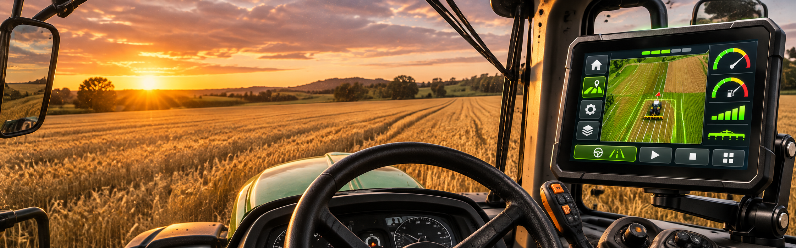
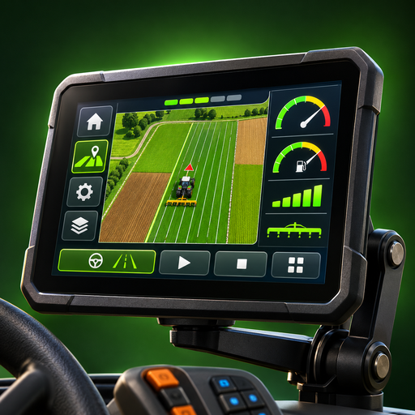

#  FS25 AutoSwitch Tablette

🇫🇷 Terminaux tablette pour AutoSwitch (Farming Simulator 25) : un terminal dans la cabine, inspiré de celui de la marque du tracteur. Mod à part : nécessite AutoSwitch. Courseplay et FarmPilot sont conseillés (leurs pages ne s'affichent que s'ils sont installés).

Téléchargement : voir la page Releases du dépôt.

----------------------------------------------------------------------------

🇬🇧 Tablet terminals for AutoSwitch (Farming Simulator 25): an in-cab terminal styled after the tractor's brand. Separate mod: requires AutoSwitch. Courseplay and FarmPilot are recommended (their pages only show when they are installed).

Download: see the repository's Releases page.

Discord : https://discord.gg/yrFBwCgtA7
